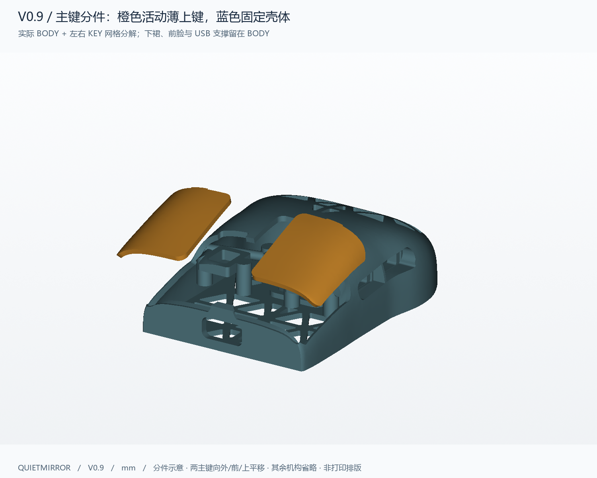
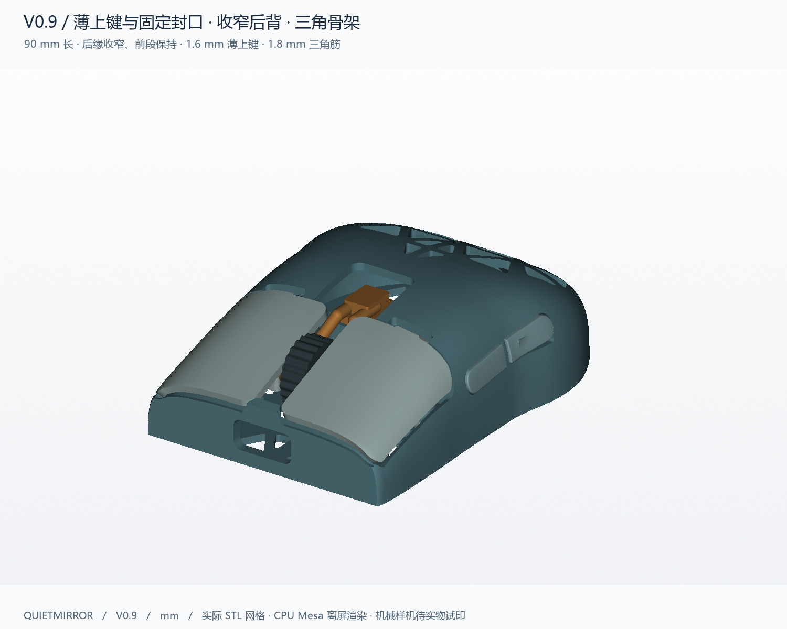
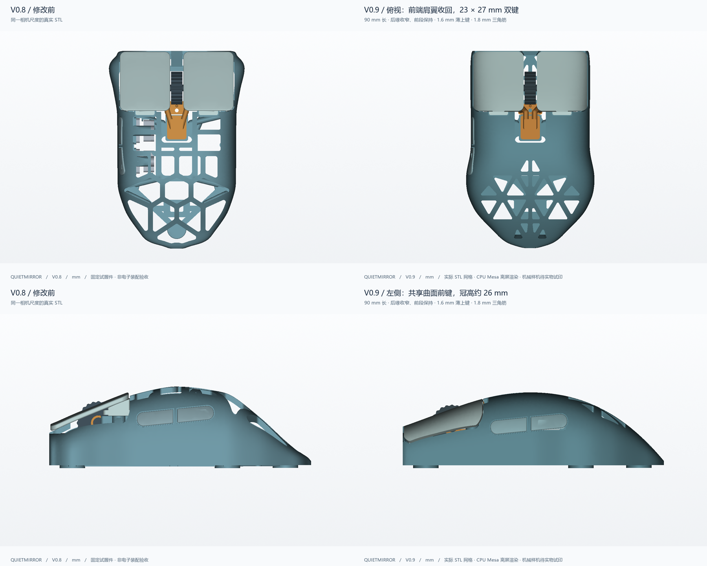

# Quietmirror V0.9 交接报告与当前进度

状态：本轮数字建模、导出、检查、PLA 切片、预览和交接文件已完成。尚未实物打印、装配、试握、测力或疲劳测试。

发布仓库：[ht1580/Quietmirror-mouse](https://github.com/ht1580/Quietmirror-mouse)，私有，main 分支。打印包发布标签为 v0.9-pla；具体提交号以仓库提交记录或 git rev-parse HEAD 为准。

## 最新要求与已完成结果

| 要求 | 当前结果 |
|---|---|
| 前端薄上键，下方封口固定 | 外母曲面裁出的 23×27 mm 接触 patch 向内法向增厚 1.6 mm；活动件不再包含下侧支撑裙 |
| 保留当前角度、不新增棱角 | 前部纵向高度函数保持；下方固定侧裙沿原母壳恢复，未添加装饰棱线 |
| 固定前脸、支撑及充电口 | 固定前鼻在 USB 两侧封闭，原 13.4×6.4 mm、圆角 1.8 mm 的功能口保留；前鼻后上方进入滚轮安装空间 |
| 去掉前端两侧突出 | 前段最大外侧位置通过无前耳检查 |
| 后部能缩就缩且连续平滑 | D54 以前保留前段宽度曲线；后肩与尾缘收窄，最终主体 X×Y×Z 为 58.696×90.094×26.002 mm |
| 镂空外缘窄筋、更多结构三角孔 | 顶部 22、底架 34 个圆角三角减重轮廓；后部边界单元重新三角剖分；后肩一对孔各额外内缩 0.50 mm、陡尾一对孔各额外内缩 0.35 mm 保证壁厚，平面筋目标 1.8 mm，自由后冠边缘约 2 mm；握持过渡和脚贴承力处保留更宽实料 |
| 避开握持区和按钮 | 主键面、侧键带、主要夹持侧壁及机构根部保留；五个脚贴、传感器、开关接口保留 |
| PLA 文件与可继续修改的源文件 | 20 件打印 STL/STEP、分件排版 3MF、原生 FreeCAD、装配 STEP、源代码及报告齐备 |

后部收窄是用户在最初 90×62 mm 基准要求后的明确修订；不能再把当前实际宽度写成 62 mm。前段保形烟测见 [rear_revision_checks.json](rear_revision_checks.json)：50 个前部曲面点相对先前模型最大高度差约 0.0142 mm。五个脚贴圆盘均完整位于新轮廓内。

## 造型纠正与结构决策

先前中间版 V2 虽完成数字验证，但其大侧裙随主键移动，不符合用户对 V3P 式前端的要求。本次改为只取母壳外表面薄片；固定 BODY 保留下方裙、前鼻和 USB 支撑。旧 V2 不是最终打印入口，备份在 E 盘支持目录，不覆盖 V0.1–V0.8。

主键底面采用法向偏置，避免全高 XY 柱裁切把内侧壁带成活动件。安装让位由外曲面扩展 patch 向内 1.95 mm 生成，并包含 0.4 mm 下压净空。向内法向偏置的隐藏背缘可能在平面投影中比外侧接触面多约 0.4 mm；23×27 mm 指实际外表面接触 patch，不包括隐藏柱塞或内侧偏置背缘。

前鼻最前约 2 mm 保持固定封口；后上方窄中央冠部清入滚轮开口，USB 顶部留出实体支撑，避免残留细长悬片。功能分件缝和安装开口不能作为多边形装饰孔删除。

充电入口另用 12.2×5.2 mm、R1.4 的声明量规沿 Y=−8..+6 mm 检查，与 20 个打印 CAD 零件无体积干涉；量规不是实际连接器规格，PCB 固定、真实插头和护线套适配仍需实物确认。

后侧键内部机构进一步下移 0.8 mm 至 Z15.1，外部接触面仍沿原侧键带。托架底面让位采用矩形本体加圆形安装耳，匹配实际托架并留 0.2 mm 平面间隙，避免旧的 18×10.2 mm 整块矩形让位在不存在托架的角落切薄顶壳。修改后重新检查实际托架、开关、行程和装入路径。

后侧键肩部装入通道沿原 4.1×11.6 mm、R0.6 轮廓向壳外延伸；35 mm 是切刀在外部空间的贯穿长度，新增让位处于导向面外侧，不改变内部导向与止挡。该让位解决下移后的肩部角在装入途中碰到侧键带下缘的问题，未改按钮接触面。

所有有意新增的减重轮廓为圆角三角形。滚轮、主键安装、侧键、USB、传感器、电源开关及紧固件等功能接口按工作需要保留其形状。孔数描述切孔轮廓，实际开口和孔缘另经保存网格的截面与射线检查；内部机构可能遮住部分视线。

最尾部两个孔保留外表面三角轮廓，内部切刀由真实外曲面片沿 (0,+6,−15) 斜扫，并限制在原三角形平面投影和 Z≥2.65 内。这样保留陡尾孔的后侧壁厚，也避免向前侵入邻筋和脚贴区域；没有靠继续缩孔或修改验收阈值跳过薄唇问题。

## 文件入口

- [参数](../../cad/parameters_v09.json)、[生成器](../../cad/build_v09.py)、[母壳与三角骨架](../../cad/geometry_v09.py)、[滚轮机构](../../cad/mechanisms_v09.py)。
- [20 件打印 STL/STEP](../../exports/v09/print/)、[PLA 排版 3MF](../../exports/v09/quietmirror_V0.9_PRINT_PLATE.3mf)、[校准件](../../exports/v09/calibration/)。
- [FreeCAD 原生文档](../../exports/v09/quietmirror_V0.9.FCStd)、[装配 STEP](../../exports/v09/quietmirror_V0.9_MECHANICAL_ASSEMBLY.step)。装配文件不可整块打印。
- [装配与实物校准](ASSEMBLY.md)、[打印说明](PRINT_README.md)、[机器可读进度](TASK_STATUS.json)。E 盘启动模板、依赖版本和工具来源保存在仓库 environment/v09，打印 ZIP 中为 environment。

FCStd 含 20 个命名 B-rep 实体、参数记录和颜色，已保存、关闭并重开验证；不伪称恢复了 CadQuery 参数历史树或已求解装配关节。继续改几何应修改参数与生成脚本，再导出，不应只改 FreeCAD 文档的说明属性。

## 数字验证与边界

- 六项尺寸、无前耳、降高、接触面与孔型验收；四项前脸封口、USB 保留、插头直线量规净空、无活动下裙验收。
- 20 个有效单实体，打印 STL 均封闭、法线一致、单连通且无检测到的自相交。
- 五个活动组各 9 个行程位置；五条装入路径各 31 个位置；静态干涉、开关示例位置、满压前端净空、五脚共面检查。
- 滚轮 3 个角度及连续圆环保守包络检查。固定侧裙、两个旧顶面薄壁位置、后斜壁、尾部、后侧键让位薄点及镜像共十五个位置使用固定坐标/法线重新验证，未靠改变随机样本隐藏失败。
- 顶孔孔缘与开口、底孔实际 Z1.8 截面、198 个主键面高度点和 177 个后背中线点检查。
- FreeCAD 来源指标与文件 SHA、切片来源 SHA、完整包 SHA256 清单及 ZIP CRC 核验。

证据：[validation.json](validation.json)、[design_checks.json](design_checks.json)、[freecad_validation.json](freecad_validation.json)、[slice_summary.json](slice_summary.json)、[package_checks.json](package_checks.json)、[source_fingerprints.json](source_fingerprints.json)。这些是有限采样和文件计算检查，不是全局强度、摩擦、连续运动或疲劳认证。

## PLA 打印与尚未完成的实物工作

通用设置：0.4 mm 喷嘴、1.75 mm PLA、0.2 mm 层高、4 壁、20% gyroid、210°C/60°C，允许可清理支撑。当前 20 件实际通用切片估算 50.21 g、6h 15m 28s；包含支撑与附着耗材。

必须选择实际打印机和耗材参数后重切。先打印 calibration 中的间隙、柱塞和轴样件，再打印整套。包中不提供未知机型可直接运行的 G-code。五枚实际轻触开关、螺钉、脚贴另备；滚轮弹片需实物调校。电子功能沿用原项目机械样机边界，本任务没有实现或实测主板、传感器和固件。

实物下一步：校准打印间隙，清理支撑，试装五键及滚轮，检查开关预压和回位，试握后再决定是否进一步减筋。不可把 CAD 空行程 0.4 mm 当作开关可压行程，详见装配说明。

## 继续修改与复现

环境、工具、依赖、配置、缓存、日志和输出均在 E:\Projects\Quietmirror\_support，项目在 E:\Projects\Quietmirror\github。先点源环境入口；几何变更后优先完整生成，不要沿用旧缓存或旧验证报告。

    . 'E:\Projects\Quietmirror\_support/enter-project.ps1'
    & 'E:\Projects\Quietmirror\_support\venv\Scripts\python.exe' cad/build_v09.py
    & 'E:\Projects\Quietmirror\_support\venv\Scripts\python.exe' cad/check_v09_acceptance.py -v
    & 'E:\Projects\Quietmirror\_support\venv\Scripts\python.exe' cad/check_v09_front_closure.py -v
    & 'E:\Projects\Quietmirror\_support\venv\Scripts\python.exe' cad/check_v09_geometry.py
    & 'E:\Projects\Quietmirror\_support\venv\Scripts\python.exe' cad/check_v09_geometry.py --metadata-only
    & 'E:\Projects\Quietmirror\_support\venv\Scripts\python.exe' cad/validate_v09.py --phase all --workers 2
    & 'E:\Projects\Quietmirror\_support\venv\Scripts\python.exe' cad/render_v09.py
    & 'E:\Projects\Quietmirror\_support\venv\Scripts\python.exe' cad/slice_v09.py
    & 'E:\Projects\Quietmirror\_support/Invoke-FreeCADCmd.ps1' 'E:\Projects\Quietmirror\github/cad/freecad_v09.py'
    & 'E:\Projects\Quietmirror\_support\venv\Scripts\python.exe' cad/package_v09.py

FreeCAD 1.1.4 与 PrusaSlicer 2.9.6 为 E 盘便携工具；PrusaSlicer 必须使用项目封装的 CPU 软件渲染设置。Python 依赖见原仓库 requirements.txt；后台任务限制两线程并使用较低优先级。

## 预览与来源

[俯视](../../views/v09/02_top.png) · [左侧](../../views/v09/03_left_side.png) · [底视](../../views/v09/04_bottom.png) · [前端封口](../../views/v09/06_front.png) · [活动薄上键与固定壳体分件](../../views/v09/08_front_roof_exploded.png)。预览由本轮实际 STL 离屏渲染，非概念图。

原始来源为 [Quietmirror/github](https://github.com/Quietmirror/github)，基准提交 c200308ceafff8805ebec9744344d4626b925dfa。origin 保留原地址，publish 指向 ht1580/Quietmirror-mouse。V0.1–V0.8 的已跟踪模型和代码保留；旧首页归档 README_V0.8.md。遵守仓库 LICENSE 与 NOTICE，商业鼠标图片仅作用户提供的外观参考。
